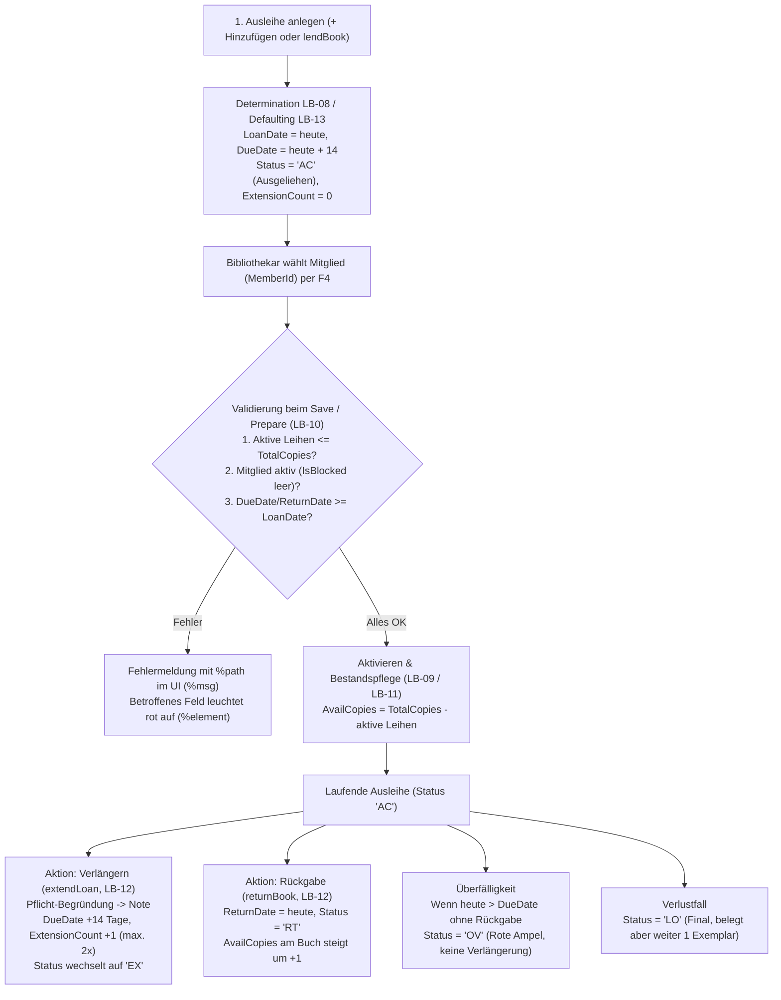
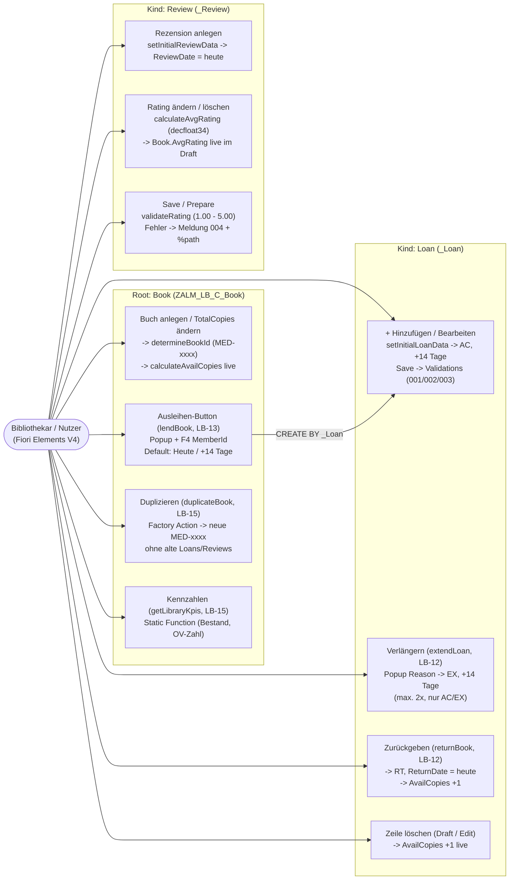
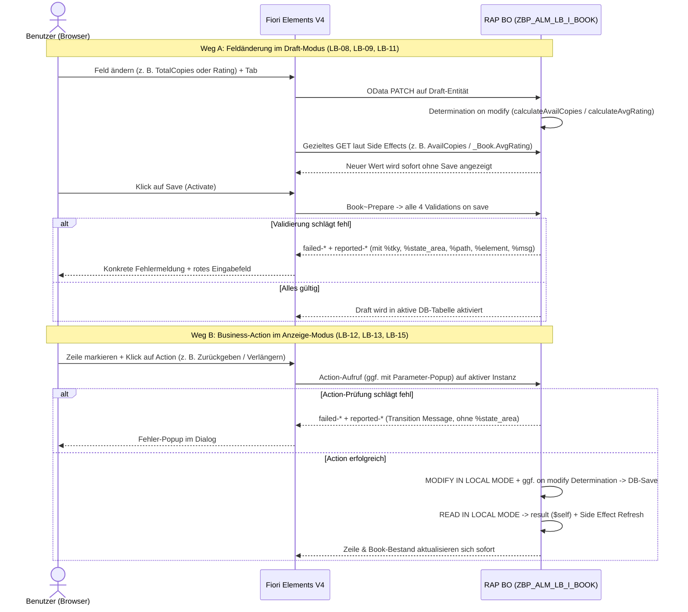

# Prozessmodell: Geschäftsprozesse & User-Interaktionen (`ZALM_LB_APP`)

Dieses Dokument beschreibt den kompletten fachlichen und technischen Lebenszyklus aller drei BO-Entitäten (**`Book`**, **`Loan`**, **`Review`**) in der Bibliotheksanwendung – inklusive Schaubildern für alle User-Interaktionen und einer durchgängigen Testfall-Matrix für manuelle UI- und EML-Tests.

---

## 1. Prozessüberblick (Ausleih-Lebenszyklus)

Der Kernprozess steuert den Lebenszyklus einer Buchausleihe von der Anlage (manuell im Draft oder per `lendBook`-Dialog) über mögliche Leihfristverlängerungen bis zur Rückgabe ins Bibliotheksregal:

---

## 2. Die Status-Matrix (`ZALM_LB_LSTATUS`)

Die Ausleihe wird über eine eigene Lookup-Tabelle gesteuert, die neben dem Text auch Steuerflags und UI-Darstellungsregeln liefert:

| Status-Code | Bezeichnung | `is_active_loan` | `is_final` | Criticality (Ampel) | Bedeutung / Wirkung |
|:---:|---|:---:|:---:|:---:|---|
| **`AC`** | **Ausgeliehen** | `'X'` | `' '` | 2 (Gelb/Neutral) | Initiale Ausleihe. Zieht 1 Exemplar von `AvailCopies` ab. |
| **`EX`** | **Verlängert** | `'X'` | `' '` | 2 (Gelb/Neutral) | Leihfrist wurde per Action verlängert. Buch bleibt entliehen. |
| **`OV`** | **Überfällig** | `'X'` | `' '` | 1 (Rot / Negativ) | Leihfrist überschritten, Buch noch nicht zurückgebracht (`Ueberfaellig`). |
| **`RT`** | **Zurückgegeben** | `' '` | `'X'` | 3 (Grün / Positiv) | Buch steht wieder physisch im Regal. Finaler Status, gibt 1 Exemplar frei. |
| **`LO`** | **Verloren** | `'X'` | `'X'` | 1 (Rot / Negativ) | Exemplar endgültig verloren (final), belegt aber weiter 1 Exemplar gegen `TotalCopies` (`AvailCopies` bleibt reduziert). |

> **Zentrales Kriterium für den Buchbestand:**  
> Alle Datensätze mit **`is_active_loan = 'X'`** (`AC`, `EX`, `OV`, `LO`) mindern den verfügbaren Bestand (`AvailCopies`)! Nur bei **`RT`** wird das Exemplar wieder freigegeben. Endgültig abgeschlossen (`is_final = 'X'`) sind **`RT`** und **`LO`**.

---

## 3. Die Phasen des Prozesses im Detail

### Phase 1: Die Schnellerfassung (LB-08)
* Der Bibliothekar navigiert auf die Object Page des gewünschten Buchs und klickt in der Tabelle *Ausleihen* auf **`+ Hinzufügen`**.
* Im selben Moment erzeugt RAP eine Zeile im Draft-Puffer.
* Die Determination **`setInitialLoanData on modify { create; }`** belegt die Felder sofort vor:
  * `LoanDate = cl_abap_context_info=>get_system_date( )`
  * `DueDate = LoanDate + 14` (Standard-Leihfrist: 2 Wochen)
  * `StatusId = 'AC'` (*Ausgeliehen*)
  * `ExtensionCount = 0`
* Der Bibliothekar wählt über die F4-Suchhilfe (`ZALM_LB_I_MEMBER`) das Mitglied aus.

### Phase 2: Prüfungen & Konsistenz (`LB-10`)
Beim Klick auf **„Save / Aktivieren“** (über `Book~Prepare`) prüfen drei Kind-Validierungen den Zustand auf `Loan` und melden Fehler per **`%path-book-%tky`** exakt an der betroffenen Zeile:
1. **`validateAvailability`:** Zählt alle aktiven Ausleihen (inkl. neuer Drafts) direkt gegen `TotalCopies` — wegen der Save-Sequence (*Determinations laufen vor Validations!*). Übersteigt die Zahl `TotalCopies` oder ist `TotalCopies <= 0`, lehnt `ZALM_LB_MSG` `003` ab.
2. **`validateMember`:** Prüft `ZALM_LB_I_MEMBER-IsBlocked`. Ist das Mitglied gesperrt, verweigert Meldung `002` die Ausleihe.
3. **`validateDates`:** Prüft, dass `DueDate >= LoanDate` und (falls gefüllt) `ReturnDate >= LoanDate` sind (Meldung `001`).

### Phase 3: Automatische Bestandspflege (`LB-09` & `LB-11`)
* **Die Herausforderung:** Die Tabelle `ZALM_LB_BOOK` hält ein redundantes, aber performantes DB-Feld `avail_copies`.
* **Die Cross-Entity Determination `calculateAvailCopies` (`on modify`):**
  * Feuert auf `Book` bei Änderung von `TotalCopies` und auf `Loan` bei `{ field StatusId; create; delete; }`.
  * Ermittelt über `_Book` das Elternbuch und über `ZALM_LB_LSTATUS` alle aktiven Ausleihen (`is_active_loan = 'X'`).
  * Setzt:
    $$\text{AvailCopies} = \max(0, \text{TotalCopies} - \text{Anzahl aktiver Ausleihen})$$
  * Über **OData V4 Side Effects** (`use side effects;` + `$self affects entity _Book;`) aktualisiert sich `AvailCopies` sofort live im UI.

### Phase 4: Aktionen während der Laufzeit (`LB-12` & `LB-14`)
1. **Frist verlängern (`extendLoan`, `LB-12`):**
   * Öffnet Parameter-Dialog (`ZALM_LB_A_ExtendParam`) mit Pflichtfeld **`Reason`**.
   * Akzeptiert nur `StatusId IN ('AC', 'EX')` (bei `OV`/`RT`/`LO` → Meldung `007`) und `ExtensionCount < 2` (sonst → Meldung `008`; fehlende Begründung → Meldung `009`).
   * Schiebt `DueDate` um **+14 Tage** weiter, erhöht `ExtensionCount` um `1`, setzt `StatusId = 'EX'` und dokumentiert die Begründung in `Note`.
2. **Buch zurückgeben (`returnBook`, `LB-12`):**
   * Akzeptiert alle aktiven, nicht-finalen Status (`AC`, `EX`, `OV`; bei `RT`/`LO` → Meldung `007`).
   * Setzt `ReturnDate = heute` und `StatusId = 'RT'`.
   * Durch den Statuswechsel schlägt `calculateAvailCopies` erneut an und erhöht `AvailCopies` am Buch live um `+1`.
3. **Dynamisches Ausgrauen (`LB-14`, `get_instance_features`):**
   * `extendLoan` wird bei `ExtensionCount >= 2` sowie Status `OV`, `RT`, `LO` ausgegraut; `returnBook` wird bei `RT` und `LO` ausgegraut.

---

## 4. Alle User-Interaktionen im Überblick (`Book`, `Loan` & `Review`)

Neben dem Ausleihprozess interagiert der Benutzer im UI auch direkt mit dem **Buch (`Book`)** und den **Rezensionen (`Review`)**:

---

## 5. Technischer Ablauf im Fiori UI (Draft vs. Direkt-Action)

Entscheidend für Verständnis und Tests sind die zwei unterschiedlichen Wege, wie RAP UI-Aktionen verarbeitet:

---

## 6. Komplette Testfall-Matrix (Gut- & Fehlerfälle)

Die folgende Matrix deckt alle Interaktionen entlang der Demodaten aus `ZCL_ALM_LB_FILL_DATA` ab (**`MED-0001`** ausgebucht, **`MED-0003`** Bewertungen, **`MED-0005`** archiviert, **`MEM-0004`** gesperrt):

### A. Buch-Stammdaten, Bestand & Book-Actions

| ID | Paket | Szenario / User-Interaktion | Erwartetes Ergebnis |
|---|---|---|---|
| **T-B1** | `LB-08` | **Neues Buch anlegen**, `BookId` leer lassen, speichern | `determineBookId` vergibt automatisch die nächste freie Nummer (`MED-xxxx`), `AvailCopies = TotalCopies`. |
| **T-B2** | `LB-09` / `LB-11` | Buch bearbeiten, `TotalCopies` erhöhen und Feld per **`Tab`** verlassen (ohne Save) | `Book~calculateAvailCopies` (`on modify`) + Side Effect aktualisieren `AvailCopies` sofort live auf dem Bildschirm. |
| **T-B3** | `LB-13` | Auf Buch mit `AvailCopies > 0` Action **„Ausleihen“ (`lendBook`)** klicken | Popup öffnet mit `LoanDate = heute` und `DueDate = +14` (`GetDefaultsForLendBook`); F4-Hilfe zeigt Mitglieder; nach OK neue Zeile in `_Loan` (`AC`) und `AvailCopies - 1`. |
| **T-B4** | `LB-13` / `LB-14` | **`lendBook` bei ausgebuchtem Buch (`MED-0001`, `AvailCopies = 0`) oder archiviertem Buch (`MED-0005`, `IsArchived = 'X'`)** | Ab `LB-14`: Button **„Ausleihen“** ist im UI ausgegraut; über EML/API lehnt der Server-Guard die Ausleihe ab. |
| **T-B5** | `LB-15` | Auf bestehendem Buch **„Duplizieren“ (`duplicateBook`)** klicken | Neue Buch-Instanz öffnet mit neuer `MED-xxxx`, Titel `... (Kopie)`, leerer ISBN, `AvailCopies = TotalCopies`, `AvgRating = 0`, ohne übernommene Ausleihen/Reviews. |
| **T-B6** | `LB-15` | **`getLibraryKpis`** per EML / OData-Service aufrufen | Liefert konsistente Summen (`TotalBooks`, `TotalCopies`, `ActiveLoans`, `OverdueLoans` auf `StatusId = 'OV'`, `AvgLibraryRating`). |

### B. Ausleihen (`Loan`) — Anlage, Validierung & Lifecycle

| ID | Paket | Szenario / User-Interaktion | Erwartetes Ergebnis |
|---|---|---|---|
| **T-L1** | `LB-08` | In `_Loan` auf **`Create` / `+ Hinzufügen`** klicken | `setInitialLoanData` belegt sofort `LoanDate = heute`, `DueDate = +14`, `StatusId = 'AC'`, `ExtensionCount = 0`. |
| **T-L2** | `LB-10` | Bei **`MED-0001`** (`TotalCopies = 2`, bereits 2 aktive Ausleihen) weitere Ausleihe anlegen und **Save** klicken | `validateAvailability` blockiert das Speichern und zeigt auf der neuen `Loan`-Zeile Meldung **`ZALM_LB_MSG 003`** (über `%path`). |
| **T-L3** | `LB-10` | Ausleihe auf gesperrtes Mitglied **`MEM-0004`** (`IsBlocked = 'X'`) anlegen und **Save** klicken | `validateMember` blockiert das Speichern; `MemberId` leuchtet rot auf, Meldung **`ZALM_LB_MSG 002`** erscheint. |
| **T-L4** | `LB-10` | `DueDate < LoanDate` oder `ReturnDate < LoanDate` eingeben und **Save** klicken | `validateDates` blockiert das Speichern; das betroffene Datumsfeld leuchtet rot auf, Meldung **`ZALM_LB_MSG 001`** erscheint. |
| **T-L5** | `LB-12` | Laufende Ausleihe (`AC` oder `EX`, `ExtensionCount < 2`) markieren → **„Verlängern“ (`extendLoan`)** mit Begründung | `DueDate` verschiebt sich um **+14 Tage**, `ExtensionCount` steigt (`0 → 1` / `1 → 2`), `StatusId = 'EX'`, Begründung steht in `Note`; `AvailCopies` bleibt unverändert. |
| **T-L6** | `LB-12` / `LB-14` | **`extendLoan` Negativfälle:** (a) Begründung leer, (b) Status `OV`/`RT`/`LO`, (c) `ExtensionCount = 2` (3. Versuch) | (a) Meldung **`009`**, (b) Meldung **`007`**, (c) Meldung **`008`**; ab `LB-14` ist der Button bei (b) und (c) bereits ausgegraut. |
| **T-L7** | `LB-12` / `LB-14` | Aktive Ausleihe (`AC`, `EX` oder `OV`) markieren → **„Zurückgeben“ (`returnBook`)** | `StatusId = 'RT'`, `ReturnDate = heute`, `AvailCopies` am Buch steigt sofort um **`+1`**; bei erneutem Klick (oder `LO`) Meldung **`007`** (ab `LB-14` Button ausgegraut). |
| **T-L8** | `LB-09` / `LB-11` | Im Edit-Modus eine aktive Ausleihe in `_Loan` **löschen** | `Loan~calculateAvailCopies` (`on modify { delete; }`) + `$self`-Side-Effect erhöhen `AvailCopies` am Buch sofort live. |

### C. Rezensionen (`Review`) — Vorbelegung, Schnitt & Bewertungsgrenzen

| ID | Paket | Szenario / User-Interaktion | Erwartetes Ergebnis |
|---|---|---|---|
| **T-R1** | `LB-08` | Neue Rezension in `_Review` per **`Create`** hinzufügen | `setInitialReviewData` setzt sofort `ReviewDate = heute`. |
| **T-R2** | `LB-09` / `LB-11` | Auf **`MED-0003`** Rating ändern (z. B. `5.00` und `5.00`) + **`Tab`**, oder Rezension löschen | `calculateAvgRating` rechnet über `decfloat34` ohne Overflow (auch bei Summe > `9.99`) und aktualisiert `AvgRating` am Buch sofort live. |
| **T-R3** | `LB-10` | Rating **`0.00`** oder **`6.00`** eingeben und **Save** klicken | `validateRating` blockiert das Speichern; über `%path-book-%tky` leuchtet `Rating` rot auf und Meldung **`ZALM_LB_MSG 004`** erscheint im Popover. |
