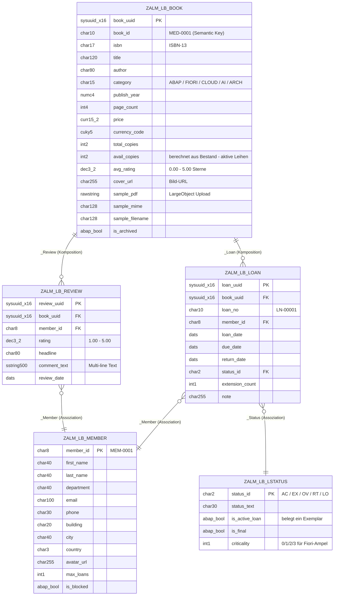

# ZALM_LB_APP — TechLibrary & Media Hub (Firmenbibliothek)

Neues RAP-Übungsprojekt **komplett from Scratch** auf **S4P On-Premise** mit **OData V4**, **Fiori Elements** (`managed; strict ( 2 ); with draft;`) und dem **CDS-Simple-Types-Ansatz** (`DRTY`).

Anders als in [`akademie`](../akademie/README.md) und [`spedition`](../spedition/README.md) ist im System noch **nichts** vorangelegt: Du baust Typen, Tabellen, Demodaten, CDS-Views, Behavior Definitions, Custom Entity (Open Library API) und die Fiori-Elements-V4-App Schritt für Schritt selbst auf.

| Eigenschaft | Wert |
|---|---|
| **System / Mandant** | S4P (`SAP_BASIS 758 SP03` / S/4HANA 2023 FPS03), Mandant `300` |
| **Paket (Vorschlag)** | `ZALM_LB_APP` (Softwarekomponente `HOME`, Transportschicht `ZS4P`, Mastersprache `DE`) |
| **Namenspräfix** | `ZALM_LB_*` |
| **BO-Stil** | `managed; strict ( 2 ); with draft;` |
| **Schlüsselstrategie** | Technische UUID (`sysuuid_x16`, `numbering : managed`) + semantischer Schlüssel `BookId` (`MED-0001`) |
| **Schwesterprojekt** | [`roesterei`](../roesterei/README.md) (`ZALM_CF_APP` — dort zusätzlich mit echtem `late numbering`!) |

---

## 1. Architektur & „CDS-only“-Einordnung auf S4P (`758 SP03`)

### Was auf S4P 2023 geht — und was (noch) nicht
Auf S/4HANA 2025 / ABAP Cloud 2502+ erlaubt das **RAP CDS Pattern** `define root table entity`, wodurch die `I_`-Root-View-Schicht und `mapping for` in der BDEF entfallen. Da unser **S4P auf Release 7.58 SP03 (S/4HANA 2023)** läuft, gilt folgende Matrix:

| Baustein | Status auf S4P (`7.58`) | Einsatz in diesem Projekt |
|---|---|---|
| **CDS Simple Types (`define type`, `DRTY`)** | ✅ Verfügbar (inkl. abapGit `DRTY`) | Ersetzen eigene klassische Datenelemente (`DTEL`) & Domänen (`DOMA`)! |
| **Ausgeschriebene Kardinalitäten** | ✅ Verfügbar | `composition of exact one to many`, `association of many to one` |
| **CDS Enumerated Types (`define type … enum`)** | ⚠️ Nur ABAP/CDS, ❌ **kein** RAP/OData | Für Status-Dropdowns nutzen wir bewusst eine Lookup-Tabelle + Value Help |
| **CDS Table Entities (`define table entity`)** | ❌ Erst ab S/4HANA 2025 | Wir nutzen schlanke `TABL`-Tabellen mit reinen Built-in-Typen + `I_`-View-Entities |
| **Draft-Tabellen als Table Entity** | ❌ Generell nicht unterstützt | Klassische `TABL` via ADT-Quickfix (wegen `%admin`-Include `SYCH_BDL_DRAFT_ADMIN_INC`) |

### Unser „7.58-CDS-Maximalansatz“ (ohne eigene `DTEL` / `DOMA`)
1. **Keine klassischen Datenelemente oder Domänen:** In den Datenbanktabellen (`TABL`) verwendest du für alle Fachspalten nackte **Built-in-Typen** (`abap.char`, `abap.int2`, `abap.dec`, `abap.curr`, …). Nur für technische Systemfelder nutzt du die SAP-Standard-Datenelemente (`sysuuid_x16`, `abp_boolean`, `abp_creation_user`, `abp_creation_tstmpl`, `abp_locinst_lastchange_user`, `abp_locinst_lastchange_tstmpl`, `abp_lastchange_tstmpl`).
2. **Fachsemantik über CDS Simple Types (`DRTY`):** Wiederkehrende Fachtypen definierst du als `define type ZALM_LB_T_...` mit `@EndUserText.label`, `@EndUserText.quickInfo`, `@EndUserText.heading` und `@ObjectModel.upperCase`.
   * **Großer Vorteil gegenüber klassischen `CHAR`-Domänen:** Bei CDS Simple Types ist `@ObjectModel.upperCase` standardmäßig **`false`** (Groß-/Kleinschreibung bleibt erhalten!). Nur für echte Codes (`BookId`, `StatusId`, `Category`) setzt du explizit `@ObjectModel.upperCase: true`.
3. **Verwendung der Simple Types an drei Stellen:**
   * In den **Interface-Views (`I_`)** per `cast( db_field as ZALM_LB_T_... preserving type ) as FieldName`.
   * In **Abstract Entities** (`define abstract entity`) direkt als Elementtyp für Action-Parameter-Dialoge.
   * In **Custom Entities** (`define custom entity`) direkt als Elementtyp für die Open-Library-API-Anbindung.

> [!WARNING]
> **Zwei wichtige Praxis-Stolpersteine bei Simple Types + RAP Draft:**
> 1. **`CAST`-Matrix beachten:** `abap.string` und `abap.rawstring` lassen sich in CDS **nicht** mit `cast(...)` konvertieren. Nutze für URLs deshalb `abap.char(255)` und für mehrzeilige Kommentare `abap.sstring(500)` – beide funktionieren sauber mit `CAST(... PRESERVING TYPE)`.
> 2. **ADT-Quickfix für Draft-Tabellen:** Wenn ein View-Feld auf einen Simple Type (`DRTY`) gecastet ist, versucht der ADT-Quickfix *„Create draft table“* manchmal, den `DRTY`-Namen in die `define table`-Draft-Tabelle zu schreiben. Da klassische `TABL`-Tabellen keine `DRTY`-Typen akzeptieren, ersetzt du den Typ in der Draft-Tabelle in diesem Fall einfach durch den identischen Built-in-Typ (z. B. `abap.char(10)`).

---

## 2. Das Datenmodell (5 Tabellen)

Ein kompaktes Modell mit **einer Root-Entität (`Book`)**, **zwei Kompositionen (`Loan`, `Review`)** und **zwei Assoziationen (`Member`, `LoanStatus`)** – maßgeschneidert für alle RAP-Backend-Muster und das *SAP Fiori Elements for OData V4 Feature Showcase*.

### Statuswerte in `ZALM_LB_LSTATUS`

| `status_id` | `status_text` | `is_active_loan` | `is_final` | `criticality` | Bedeutung |
|---|---|:--:|:--:|---:|---|
| `AC` | Ausgeliehen | `X` | `' '` | `2` (Gelb/Warnung) | Regulär im Umlauf |
| `EX` | Verlängert | `X` | `' '` | `2` (Gelb) | Frist bereits verlängert |
| `OV` | Überfällig | `X` | `' '` | `1` (Rot) | Rückgabedatum überschritten |
| `RT` | Zurückgegeben | `' '` | `X` | `3` (Grün) | Exemplar wieder im Regal |
| `LO` | Verloren | `X` | `X` | `1` (Rot) | Dauerhaft aus Bestand |

---

## 3. Empfohlene Testfälle für deine Befüllklasse (`ZCL_ALM_LB_FILL_DATA`)

Baue dir in Aufgabe **LB-02** eine Klasse mit `INTERFACES if_oo_adt_classrun`, die alle 5 Tabellen leert und frisch befüllt (jederzeit per `F9` in Eclipse ausführbar). Baue dir direkt ein paar **interessante Grenzfälle** für die späteren Validierungen und Actions ein:

1. **Ausgebuchter Klassiker (`MED-0001`):** `total_copies = 2`, bereits 2 aktive Ausleihen (`AC` + `OV`), `avail_copies = 0` → kein weiteres Ausleihen möglich.
2. **Überfällige Ausleihe mit max. Verlängerungen:** Eine Ausleihe mit `due_date` in der Vergangenheit und `extension_count = 2` → darf nicht ein drittes Mal verlängert werden.
3. **Gesperrtes Mitglied (`MEM-0004`):** `is_blocked = 'X'`, besitzt noch ein altes überfälliges Buch → darf keine neuen Bücher ausleihen.
4. **Abweichender Durchschnitt (`MED-0003`):** Hat 2 Rezensionen (5.00 und 3.00 Sterne), `avg_rating` steht initial aber noch auf `0.00` → perfekt zum Testen deiner späteren Determination!
5. **Archiviertes Buch (`MED-0005`):** `is_archived = 'X'` → später per Dynamic Feature Control für Bearbeitung und neue Ausleihen gesperrt.

---

## 4. Namenskonventionen

| Schicht / Objekt | Namensmuster | Beispiele |
|---|---|---|
| **CDS Simple Types (`DRTY`)** | `ZALM_LB_T_<Name>` | `ZALM_LB_T_BookId`, `ZALM_LB_T_Isbn`, `ZALM_LB_T_Rating` |
| **Aktive Tabellen (`TABL`)** | `ZALM_LB_<ENTITY>` | `ZALM_LB_BOOK`, `ZALM_LB_LOAN`, `ZALM_LB_REVIEW`, `ZALM_LB_MEMBER`, `ZALM_LB_LSTATUS` |
| **Draft-Tabellen (`TABL`)** | `ZALM_LB_D_<ENTITY>` | `ZALM_LB_D_BOOK`, `ZALM_LB_D_LOAN`, `ZALM_LB_D_REVIEW` |
| **Interface-Views (`DDLS`)** | `ZALM_LB_I_<Entity>` | `ZALM_LB_I_Book`, `ZALM_LB_I_Loan`, `ZALM_LB_I_Review`, `ZALM_LB_I_Member`, `ZALM_LB_I_LoanStatus` |
| **Projection-Views (`DDLS`)** | `ZALM_LB_C_<Entity>` | `ZALM_LB_C_Book`, `ZALM_LB_C_Loan`, `ZALM_LB_C_Review` |
| **Metadata Extensions (`DDLX`)** | `ZALM_LB_C_<Entity>` | gleicher Name wie Projection-View |
| **Abstract Entities (`DDLS`)** | `ZALM_LB_A_<Purpose>` | `ZALM_LB_A_LendParam`, `ZALM_LB_A_ExtendParam` *(ab Stufe C)* |
| **Custom Entity (`DDLS`)** | `ZALM_LB_CE_<Name>` | `ZALM_LB_CE_OpenLibBook` *(ab Stufe D)* |
| **Behavior Definitions (`BDEF`)** | Name = Root-View | `ZALM_LB_I_Book` (Basis) & `ZALM_LB_C_Book` (Projektion) |
| **Behavior Pool (`CLAS`)** | `ZBP_ALM_LB_I_BOOK` | Handler & Saver |
| **Service Definition (`SRVD`)** | `ZALM_LB_SD_LIBRARY` | exponiert BO + Lookup/VH + später Custom Entity |
| **Service Binding (`SRVB`)** | `ZALM_LB_UI_LIBRARY_O4` | Typ **OData V4 - UI** |

---

## 5. Projekt-Roadmap

* **Stufe A — Fundament (`LB-01` bis `LB-06`, jetzt in [AUFGABEN.md](AUFGABEN.md)):** Paket, CDS Simple Types, Tabellen, F9-Datenklasse, Interface-/Projection-Views, Draft-BDEF, OData-V4-Service & Basis-UI.
* **Stufe B — Determinations & Validations *(folgt als Nächstes)*:** Automatische `BookId` (`MED-nnnn`), Live-Berechnung von `AvailCopies` und `AvgRating`, `Prepare`-Validierungen, Nachrichtenklasse.
* **Stufe C — Actions, Parameter-Dialoge, Defaulting & Feature Control:** `lendBook` mit Wertehilfe & `default function`, `extendLoan` mit Pflichtbegründung, `returnBook`, Factory Action `duplicateBook`, Function `getMemberStats`, dynamisches Ausgrauen.
* **Stufe D — Custom Entity & Open Library API:** Live-Buchsuche per `CL_WEB_HTTP_CLIENT_MANAGER` gegen `openlibrary.org` inkl. **automatischem Offline-JSON-Fallback** + 1-Klick-Import-Action ins eigene BO.
* **Stufe E — Fiori Elements OData V4 Feature Showcase (Backend & Frontend):** Rating-Sterne, Radial/Harvey Micro Chart, Contact Quick View (`#AS_CONTACT`), PDF-Upload (`@Semantics.largeObject`), Multi-View-Tabs im List Report, Flexible Column Layout, Controller Extensions & Custom Section in deiner generierten Fiori-App.

